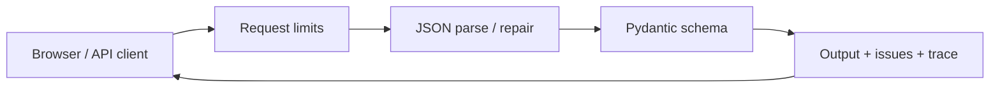

# SchemaGuard project guide

SchemaGuard helps developers validate LLM-style JSON and understand failures. It repairs syntax conservatively, validates three strict schemas, and returns the actual repair trace. It makes no model calls and persists no submissions.

## Main features

- Editable playground at `/` and `/playground`; six examples per schema.
- Required-field/type issues, syntax repairs, explicit sample fallback.
- Safe formatting, copy/reset, expanded editors, Cmd/Ctrl+Enter execution.
- Real public API plus `/docs`, `/redoc`, and `/openapi.json`; no login.

Try strict JSON first. On parse failure, try fences → single-quoted strings → trailing commas. Stop once JSON parses, even if fields fail validation. Never guess fields/brackets or coerce types. Explicit fallback must also match the schema; it replaces failed input rather than repairing it.

| Schema         | Required fields / main rules                                                                             |
| -------------- | -------------------------------------------------------------------------------------------------------- |
| UserProfile    | `name`: nonempty string; `age`: integer 0–150; `skills`: string list                                     |
| ProductListing | `title`: nonempty string; `price`: non-negative number; `currency`: USD/EUR/GBP/INR; `in_stock`: boolean |
| SupportTicket  | `subject`, `description`: nonempty strings; `priority`: low/medium/high; `tags`: string list             |

Extra fields are rejected. `/v1/schemas` returns full length/list constraints.

## Architecture

| Location                                       | Responsibility                                                    |
| ---------------------------------------------- | ----------------------------------------------------------------- |
| `app/main.py`                                  | FastAPI/Starlette API, Pydantic schemas, repair and safety guards |
| `app/run.py`, `app/pages.py`                   | Uvicorn startup; shared pages/docs/404 chrome                     |
| `app/static/`                                  | Vanilla HTML/JS/CSS, local fonts/icons, design tokens             |
| `scripts/`, `tests/`                           | Node static build/checks; pytest regression coverage              |
| Requirements, CI, Docker/Railway/Vercel config | Dependencies, checks, recorded hosting setup                      |

Local FastAPI serves UI and API together. Recorded hosting is Vercel static frontend → Railway FastAPI; PostgreSQL/Neon is only an optional health probe. No React, accounts, persistence workflow, or migrations. [Detailed module map](ARCHITECTURE.md).

## API and boundaries

| Endpoint                         | Contract                                                                                                   |
| -------------------------------- | ---------------------------------------------------------------------------------------------------------- |
| `GET /health`, `GET /v1/schemas` | Readiness; schema definitions                                                                              |
| `POST /v1/validate`              | `raw_output` string; optional `schema_name` (UserProfile), `max_retries` (3, range 0–3), `fallback` object |
| `POST /v1/format`                | `raw_output` string → safely formatted JSON; no business-schema validation                                 |
| `GET /health/database`           | Optional `SELECT 1` probe; 503 if missing/unavailable                                                      |

Results contain `status`, `output`, `validation_errors`, `repair_steps`, and legacy aliases (`success`, `data`, `retries`, `fallback`, `repair_log`, `error`). Status is valid/repaired/failure/fallback; `success` remains false for fallback. Schema failure returns HTTP 200; request errors use 422/404/413/408/429. Rate limits include `Retry-After: 60`.

Limits: 16,384 input characters, 64 KiB body, 32 nesting levels, 4,096 parsed values, 10-second body-read timeout per chunk. Default POST limits: 60/minute per peer, 180/minute globally, at most 2,048 peer buckets. One standard worker, 64 concurrent tasks/connections; counters are per-process, reset on restart, and are not distributed.

Duplicates, non-finite numbers, truncated input, and surrounding prose remain failures. Input stays in request memory and out of application logs; infrastructure may log independently. Input-derived output uses text nodes.

## Current status — 2026-10-12

**Working:** clean installation/startup, core API, 21 demo cases, 43 tests (96.37% coverage), static build/checks, browser repair and field-error output. Examples are fixtures; responses are real, not mocked.

**Intentional limits:** only built-in schemas; no custom-schema editor, accounts/history, or guaranteed recovery. `LLM_PROVIDER` is unused.

**Known issues/unknowns:** existing Starlette/httpx test warning; ReDoc CSP blocks a search worker and remote branding image (reference loads; search not fully verified). Live database, hosted deployments, Docker execution, and a complete uninterrupted browser demo were not verified. [Demo evidence](DEMO_GUIDE.md#verification).
